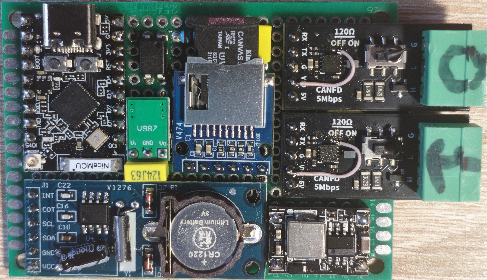
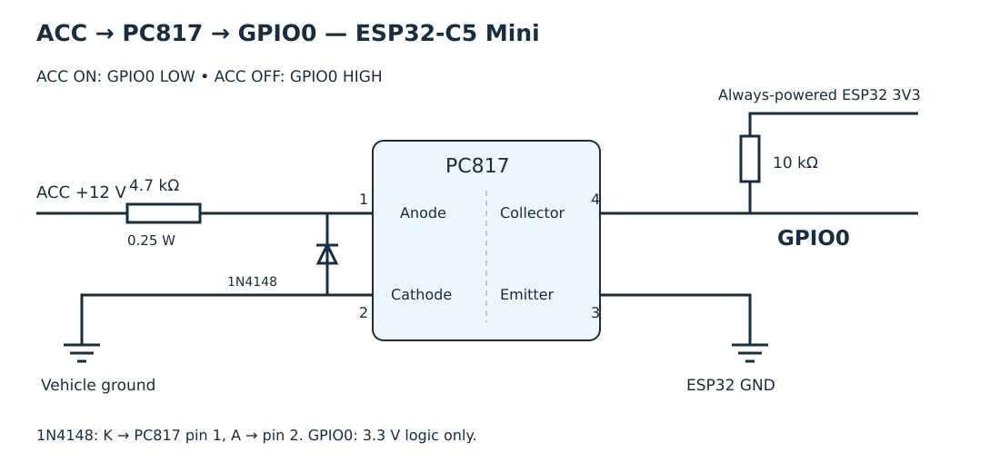
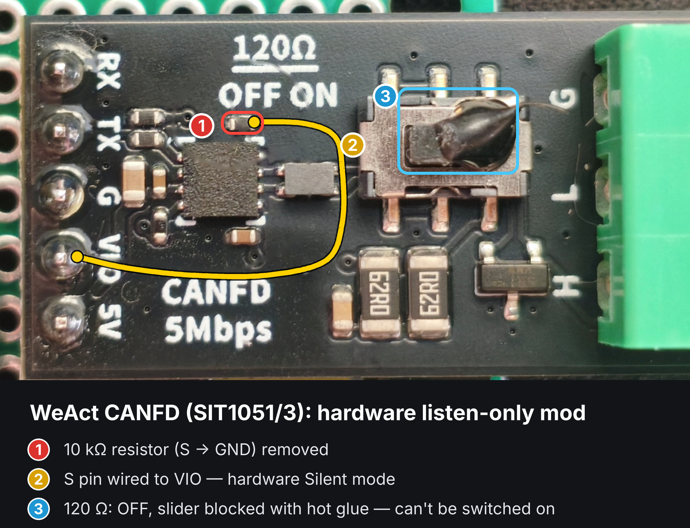

# Dual CAN / CAN FD Sniffer — ESP32-C5 Mini

[Русская версия](README_RU.md)

A standalone two-channel CAN sniffer and SD-card logger based on the **ESP32-C5 Mini**. It receives traffic from two independent buses, combines frames on a shared time base, and saves compressed binary logs to a microSD card. A Wi-Fi web portal provides access to logs and bus settings.

The device is a **passive sniffer-logger**: both CAN controllers run in listen-only mode, and no CAN TX GPIO is assigned.

## Device board



## Features

- Two independent receive channels: CAN0 and CAN1.
- Standard 11-bit and extended 29-bit identifiers; frame flags are preserved in the binary log.
- Microsecond receive timestamps and periodic anchors to the system clock.
- Binary logs compressed with **heatshrink (LZSS)**.
- **PCF8563 RTC** for date and time at startup.
- Wi-Fi access point: 5 GHz, channel 36, with fallback to 2.4 GHz, channel 6 if AP startup fails.
- Russian / English web interface; language and bus settings are saved in NVS.
- Downloads of individual logs or a whole date folder as TAR.
- Received / dropped frame counters and an error log.
- BOOT button mode for safe SD-card removal.

**CAN FD status:** the receive path handles FD/BRS flags and payloads up to 64 bytes, and the driver accepts a data-phase bitrate. However, the current defaults are **Classic CAN at 500 kbit/s on both channels**, and the portal only configures the nominal bitrate. CAN FD data-phase settings require a source-code change; there is no CAN FD selector in the current portal. Use transceivers suitable for the intended data rate.

## Repository layout

| Path | Contents |
|---|---|
| [`dual_can_fd_sniffer.ino`](dual_can_fd_sniffer.ino) | ESP32-C5 firmware |
| [`src/heatshrink/`](src/heatshrink/) | Third-party heatshrink encoder sources |
| [`docs/`](docs/) | Wiring diagrams, board photo and WeAct Studio CANFD V1 modification images |
| [`tools/log_unpack.py`](tools/log_unpack.py) | Binary log decompression and text export |
| [`LICENSE`](LICENSE) | Project license |

## Wiring diagram


[English diagram](docs/Scheme%20Dual%20channels%20CAN-Sniffer%20ESP32-C5%20based%20EN.png) · [Russian diagram](docs/Scheme%20Dual%20channels%20CAN-Sniffer%20ESP32-C5%20based%20RUS.png)

## ACC ignition input, PC817 and sleep



| PC817 connection | Signal |
|---|---|
| 1 — anode | ACC +12 V through 4.7 kohm, 0.25 W resistor |
| 2 — cathode | Vehicle ground |
| 4 — collector | **GPIO0**, external **10 kohm pull-up to ESP32 3V3** |
| 3 — emitter | ESP32 GND |

Fit a reverse diode across the PC817 LED: cathode to pin 1, anode to pin 2. GPIO0 receives a 3.3 V logic signal only. The external pull-up must remain powered during sleep.

- ACC on: GPIO0 = LOW; sleep is blocked.
- ACC off: GPIO0 = HIGH. Sleep is allowed only after the portal is off and no USB host has been detected for **5 seconds**.
- **An enabled portal access point blocks sleep even without clients**. The existing AP policy remains: off after 5 minutes without a client, or after the client disconnects.
- Native USB Serial/JTAG host activity blocks sleep even with Serial Monitor closed. A charger or power-only cable cannot be distinguished from other power sources in software; detecting any USB power requires a separate VBUS sense input.
- Before sleep, both CAN controllers stop, the open log's queued frames are drained, compression finishes, the file closes and SD is unmounted. Sleep also works with missing SD or silent CAN buses.
- GPIO0 LOW (ACC on) wakes the device, restarting `setup()` and the portal. Press RESET when connecting USB to an already sleeping device; USB is not configured as a wake source.

Sleep powers down the ESP32 and radio, but does not disconnect the SD/DC–DC or transceiver supplies. S and VIO remain wired to 3V3 as in the main diagram. Keep the device powered after ACC goes off so that it can finish the log.

## Hardware and connections

- ESP32-C5 Mini; PSRAM is not required.
- Two CAN transceivers with 3.3 V logic and a hardware silent-mode input, such as **TJA1051T/3**.
- SPI microSD module with 3.3 V supply and logic.
- Separate **5 V → 3.3 V DC–DC converter** for the SD module.
- PCF8563 RTC module with backup battery.
- Regulated 5 V power supply.

| Signal | ESP32-C5 Mini / connection |
|---|---|
| CAN0 transceiver RXD / CRX | GPIO5 |
| CAN1 transceiver RXD / CRX | GPIO4 |
| CAN TX | No GPIO assigned; not connected to the ESP32 |
| SD CS | GPIO10 |
| SD MOSI | GPIO9 |
| SD SCK | GPIO8 |
| SD MISO | GPIO7 |
| RTC SDA | GPIO1 |
| RTC SCL | GPIO6 |
| BOOT button | GPIO28, active LOW |

### Power

| Connection | Supply |
|---|---|
| ESP32-C5 Mini 5V input | Regulated 5 V |
| VCC of both transceivers | 5 V |
| VIO and S of both transceivers | **3V3 output of the ESP32-C5 Mini** |
| SD module VCC | **3.3 V output of its separate DC–DC converter** |
| RTC VCC | ESP32-C5 Mini 3V3 |
| All GND pins | Common ground |

Do not join the output of the SD converter to the ESP32 board's 3V3 output. On TJA1051T/3, tying **S to VIO** selects hardware silent mode. Connect each transceiver's CANH/CANL to its respective bus; the two buses are not bridged.

## WeAct Studio CANFD V1 modification

The image below shows the WeAct Studio CANFD V1 module modification for use with this sniffer.



[English image](docs/weact_canfd_mod_en.png) · [Russian image](docs/weact_canfd_mod_ru.png)

## Build and flash

1. Install Arduino IDE and an Arduino-ESP32 core with **ESP32-C5**, the new TWAI node API (`esp_twai.h`, `esp_twai_onchip.h`) and the Wi-Fi band API used by the sketch.
2. Place `dual_can_fd_sniffer.ino` and `src/` together in a sketch folder named **`dual_can_fd_sniffer`**. The GitHub repository name differs from the required Arduino sketch-folder name.
3. Ensure all four heatshrink files are together in `src/heatshrink/`: `heatshrink_common.h`, `heatshrink_config.h`, `heatshrink_encoder.h`, and `heatshrink_encoder.c`. If `heatshrink_common.h` is in a directory named `heatshrink ` with a trailing space, move it into `src/heatshrink/` before building.
4. Select the ESP32-C5 board profile matching your Mini board and its actual flash size. Enable USB CDC on boot if needed for Serial over native USB.
5. Review GPIO definitions and `AP_SSID` / `AP_PASS`, then compile and upload over USB. Serial speed: **115200 baud**.

The sketch uses the ESP32 core libraries and the bundled heatshrink sources. PCF8563 support is implemented directly in the sketch.

## Operation

1. Insert a microSD card with a filesystem supported by the installed ESP32 SD library, and power the device.
2. Both channels are enabled by default. Recording starts after **any enabled channel has received traffic**. For a single-bus installation, disable the unused channel in the portal.
3. To configure the device or download logs, connect to **`C5-SNIFFER`**, password **`canlogger`**, and open **http://192.168.4.1/**. The actual AP address is also printed in Serial.
4. Open **Bus settings** to enable channels, assign names (up to 7 characters), and choose nominal bitrates: **100, 125, 250, 500 or 1000 kbit/s**. Saving restarts the device.
5. Open **Logs on card** to download individual files, download a day as TAR, or delete a date folder. **Error log** displays recorded errors and provides a clear button.

**Connecting a Wi-Fi client pauses recording and closes the current log.** Frames received during the pause are discarded. When the client disconnects, Wi-Fi switches off and recording can resume after fresh traffic has arrived on any enabled channel. Without a client, the AP switches off after **5 minutes**. Reset the device to make the AP available again.

To remove the card, press and hold **BOOT on the running device** for at least **100 ms**. The firmware disables CAN reception, closes the log, unmounts SD and stops Wi-Fi. Wait for `Card is safe to remove. Press RESET to continue.` in Serial. Press RESET to resume operation.

### Clock

At startup, the firmware reads the PCF8563 if it is present and its time is valid. It then uses the ESP32 system clock. **Set the RTC before use**: the current portal does not provide a clock-setting page. Without valid RTC time, date folders and exported calendar timestamps will not be meaningful. The firmware and unpacker treat calendar time as UTC.

## Logs

Files are stored as **`/YYYY-MM-DD/can_NNNN.hs`**. Both channels share one file; every frame includes its channel index, timestamp, identifier, length, flags and payload. The decompressed stream starts with a `C5CAN` header.

- A file opens when any enabled channel becomes active; traffic on the other channel is not required.
- Rotation occurs at **10 MiB of uncompressed binary data**, not 10 MiB on the card.
- A file closes after **10 seconds without received traffic**. Opening the next file requires new activity on any enabled channel.
- Time anchors are added every **60 seconds**.
- The write buffer is submitted to the compressor about every **500 ms**, or when full; this does not guarantee recovery of all recent data after sudden power loss.
- The date directory is chosen when a file opens. An already open file is not rotated just because midnight has passed.
- `/errors.log` rotates to `/errors.old.log` above **256 KiB**.

### Unpack and export

Install Python 3 and the unpacker's dependency:

```bash
python -m pip install heatshrink2
```

Run these commands from the repository root:

```bash
# Separate text files per bus: can_0000_CAN0.txt, can_0000_CAN1.txt
python tools/log_unpack.py can_0000.hs

# Both buses in one text file, with bus labels
python tools/log_unpack.py can_0000.hs --merge --bus-tag

# Export CAN0 and a specific CAN ID to a chosen file
python tools/log_unpack.py can_0000.hs --bus 0 --id 0x30B -o can0_30B.txt

# Recursively process every .hs file in a directory
python tools/log_unpack.py logs --dir --merge --bus-tag
```

`--merge` combines channels **within each input file**; it does not concatenate a directory into one file. Do not combine `--dir` with a shared `-o` path: each input overwrites that output. The tool attempts to decode truncated streams, but recovery is not guaranteed.

Example text output:

```text
2026-11-05 12:00:00.123 [CAN0] ID:0x30B D:00 11 22 33 44 55 66 77
```

## License and third-party code

The project is distributed under the **MIT License**; see [`LICENSE`](LICENSE).

Log compression uses **heatshrink 0.4.1**, a third-party LZSS library whose encoder sources are included in [`src/heatshrink/`](src/heatshrink/).

- Author: **Scott Vokes** — [vokes.s@gmail.com](mailto:vokes.s@gmail.com).
- Upstream project: [atomicobject/heatshrink](https://github.com/atomicobject/heatshrink).
- heatshrink has its own **ISC license**; retain the upstream copyright and permission notice when redistributing its sources. See the [upstream license](https://github.com/atomicobject/heatshrink/blob/master/LICENSE).
