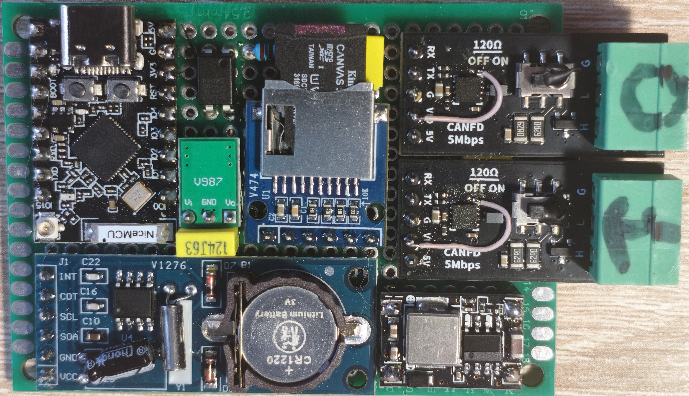
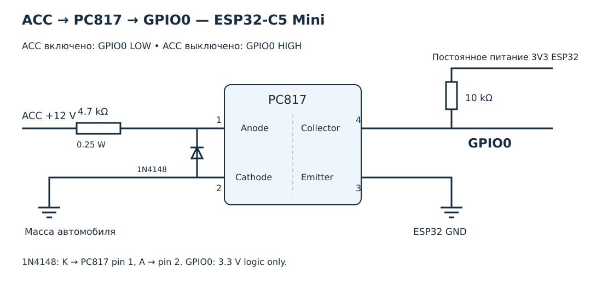
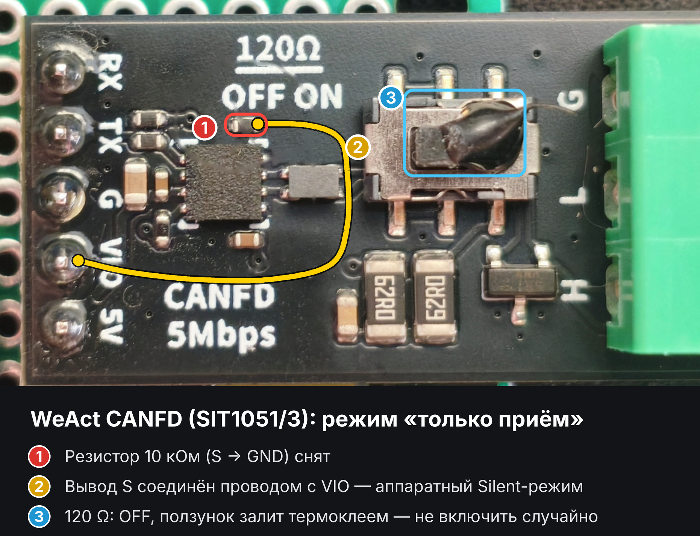

# Двухканальный CAN / CAN FD сниффер — ESP32-C5 Mini

[English version](README.md)

Автономный двухканальный CAN-сниффер и SD-логгер на базе **ESP32-C5 Mini**. Принимает трафик двух независимых шин, объединяет кадры на общей временной шкале и сохраняет сжатые бинарные логи на microSD. Веб-портал по Wi-Fi позволяет скачивать логи и настраивать каналы.

Устройство работает как **пассивный сниффер-логгер**: оба CAN-контроллера включены в режиме listen-only, GPIO для передачи CAN не назначен.

## Плата устройства



## Возможности

- Два независимых приёмных канала: CAN0 и CAN1.
- Стандартные 11-битные и расширенные 29-битные идентификаторы; флаги кадров сохраняются в бинарном логе.
- Микросекундные метки приёма и периодические привязки к системному времени.
- Сжатие бинарных логов библиотекой **heatshrink (LZSS)**.
- **RTC PCF8563** для установки даты и времени при запуске.
- Точка доступа Wi-Fi: 5 ГГц, канал 36; при ошибке запуска — переход на 2,4 ГГц, канал 6.
- Веб-интерфейс на русском и английском; язык и настройки каналов сохраняются в NVS.
- Скачивание отдельных логов или всей папки за дату в TAR.
- Счётчики принятых и потерянных кадров, журнал ошибок.
- Режим безопасного извлечения SD-карты по кнопке BOOT.

**CAN FD:** режим и скорости настраиваются независимо для CAN0 и CAN1 в портале и сохраняются в NVS. Для каждого канала доступны **Classic CAN** и **CAN FD**; номинальная скорость — **100, 125, 250, 500, 800 или 1000 кбит/с**. В FD скорость данных выбирается из того же списка и **2, 4, 5 или 8 Мбит/с**, не ниже номинальной. По умолчанию — Classic CAN, 500 кбит/с. В режиме FD принимаются также Classic-кадры; FD-кадры с BRS используют выбранную скорость данных, без BRS — номинальную скорость. Флаги FD/BRS и до 64 байт данных сохраняются в логе и выводятся распаковщиком. Используйте трансиверы и проводку, рассчитанные на выбранную скорость; 8 Мбит/с — доступная настройка, а не подтверждённая на вашем устройстве скорость.

## Структура репозитория

| Путь | Содержимое |
|---|---|
| [`dual_can_fd_sniffer.ino`](dual_can_fd_sniffer.ino) | Прошивка ESP32-C5 |
| [`src/heatshrink/`](src/heatshrink/) | Исходники стороннего кодировщика heatshrink |
| [`docs/`](docs/) | Схемы подключения, фото платы и изображения доработки WeAct Studio CANFD V1 |
| [`tools/log_unpack.py`](tools/log_unpack.py) | Распаковка бинарных логов и экспорт в текст |
| [`LICENSE`](LICENSE) | Лицензия проекта |

## Схема подключения


[Схема на русском](docs/Scheme%20Dual%20channels%20CAN-Sniffer%20ESP32-C5%20based%20RUS.png) · [Схема на английском](docs/Scheme%20Dual%20channels%20CAN-Sniffer%20ESP32-C5%20based%20EN.png)

## Зажигание ACC, PC817 и сон



| Подключение PC817 | Сигнал |
|---|---|
| 1 — анод | ACC +12 В через резистор 4,7 кОм, 0,25 Вт |
| 2 — катод | Масса автомобиля |
| 4 — коллектор | **GPIO0**, внешняя подтяжка **10 кОм к 3V3 ESP32** |
| 3 — эмиттер | GND ESP32 |

Параллельно светодиоду PC817 установите обратный диод: катод к выводу 1, анод к выводу 2. На GPIO0 поступает только логический сигнал 3,3 В. Внешняя подтяжка должна оставаться под питанием во сне.

- ACC включено: GPIO0 = LOW; работа разрешена, сон заблокирован.
- ACC выключено: GPIO0 = HIGH. Сон разрешён, только если портал выключен и USB-хоста нет в течение **5 секунд**.
- **Включённая точка доступа портала блокирует сон даже без клиентов**. Без клиента она отключается через 5 минут; после отключения клиента — сразу, как и ранее.
- USB-хост определяется по активности native USB Serial/JTAG, без необходимости открывать Serial Monitor. Зарядку и кабель без линий данных программно отличить от другого питания нельзя: для блокировки сна от любого USB-питания нужен отдельный вход определения VBUS.
- Перед сном останавливаются оба CAN-контроллера, дописывается очередь открытого лога, завершается сжатие, закрывается файл и размонтируется SD. Сон работает и при отсутствии SD или трафика CAN.
- Пробуждение — по LOW на GPIO0 (включение ACC); затем прошивка заново запускает `setup()` и портал. Чтобы подключить USB к уже спящему устройству, нажмите RESET; USB не настроен как источник пробуждения.

Сон выключает ESP32 и радио, но не снимает питание с SD/DC–DC и трансиверов. Их S и VIO остаются подключены к 3V3, как на основной схеме. Постоянное питание устройства должно сохраняться после выключения ACC, чтобы оно успело закрыть лог.

## Компоненты и подключения

- ESP32-C5 Mini; PSRAM не требуется.
- Два CAN-трансивера с логикой 3,3 В и входом аппаратного тихого режима, например **TJA1051T/3**.
- SPI-модуль microSD с питанием и логикой 3,3 В.
- Отдельный **DC–DC-преобразователь 5 → 3,3 В** для SD-модуля.
- RTC PCF8563 с резервной батарейкой.
- Стабилизированный источник питания 5 В.

| Сигнал | ESP32-C5 Mini / подключение |
|---|---|
| RXD / CRX трансивера CAN0 | GPIO5 |
| RXD / CRX трансивера CAN1 | GPIO4 |
| CAN TX | GPIO не назначен; к ESP32 не подключается |
| SD CS | GPIO10 |
| SD MOSI | GPIO9 |
| SD SCK | GPIO8 |
| SD MISO | GPIO7 |
| RTC SDA | GPIO1 |
| RTC SCL | GPIO6 |
| Кнопка BOOT | GPIO28, активный уровень LOW |

### Питание

| Подключение | Источник |
|---|---|
| Вход 5V ESP32-C5 Mini | Стабилизированные 5 В |
| VCC обоих трансиверов | 5 В |
| VIO и S обоих трансиверов | **Выход 3V3 платы ESP32-C5 Mini** |
| VCC SD-модуля | **Выход 3,3 В отдельного DC–DC-преобразователя** |
| VCC RTC | 3V3 платы ESP32-C5 Mini |
| Все GND | Общая земля |

Выход преобразователя SD и выход 3V3 платы ESP32 между собой не соединяются. На TJA1051T/3 соединение **S с VIO** включает аппаратный тихий режим. CANH/CANL каждого трансивера подключаются к своей шине; устройство не объединяет две шины.

## Доработка WeAct Studio CANFD V1

Доработка модуля WeAct Studio CANFD V1 для использования в сниффере показана на изображении ниже.



[Изображение на русском](docs/weact_canfd_mod_ru.png) · [Изображение на английском](docs/weact_canfd_mod_en.png)

## Сборка и прошивка

1. Установите Arduino IDE и ядро Arduino-ESP32 с поддержкой **ESP32-C5**, нового TWAI node API (`esp_twai.h`, `esp_twai_onchip.h`) и используемого в скетче API выбора диапазона Wi-Fi.
2. Поместите `dual_can_fd_sniffer.ino` и `src/` в общую папку скетча **`dual_can_fd_sniffer`**. Имя репозитория GitHub отличается от имени папки, требуемого Arduino.
3. Убедитесь, что все четыре файла heatshrink лежат вместе в `src/heatshrink/`: `heatshrink_common.h`, `heatshrink_config.h`, `heatshrink_encoder.h` и `heatshrink_encoder.c`. Если `heatshrink_common.h` находится в каталоге `heatshrink ` с пробелом в конце имени, перед сборкой перенесите его в `src/heatshrink/`.
4. Выберите профиль ESP32-C5, соответствующий вашей Mini-плате, и её фактический объём flash. При необходимости включите USB CDC On Boot для Serial через встроенный USB.
5. Проверьте определения GPIO и `AP_SSID` / `AP_PASS`, затем соберите и загрузите прошивку по USB. Скорость Serial: **115200 бод**.

Используются библиотеки из ядра ESP32 и включённые в проект исходники heatshrink. Работа с PCF8563 реализована непосредственно в скетче.

## Использование

1. Установите microSD с файловой системой, поддерживаемой установленной библиотекой ESP32 SD, и подайте питание.
2. По умолчанию включены оба канала. Запись начинается после того, как **любой включённый канал принял трафик**. При подключении к одной шине отключите неиспользуемый канал в портале.
3. Для настройки или скачивания логов подключитесь к **`C5-SNIFFER`**, пароль **`canlogger`**, и откройте **http://192.168.4.1/**. Фактический адрес точки доступа также выводится в Serial.
4. В разделе **«Настройки шин»** можно включать каналы, задавать имена длиной до 7 байт и выбирать режим Classic CAN / CAN FD, номинальную скорость и скорость данных FD. Сохранение настроек перезагружает устройство.
5. В разделе **«Логи на карте»** доступны отдельные файлы, скачивание дня в TAR и удаление папки за дату. Раздел **«Журнал ошибок»** показывает ошибки и позволяет очистить журнал.

**Подключение Wi-Fi-клиента приостанавливает запись и закрывает текущий лог.** Кадры, принятые во время паузы, отбрасываются. После отключения клиента Wi-Fi выключается; запись может возобновиться после новой активности на любом включённом канале. Если клиент не подключался, точка доступа выключается через **5 минут**. Чтобы снова включить её, перезагрузите устройство.

Для извлечения карты нажмите и удерживайте **BOOT на работающем устройстве** не менее **100 мс**. Прошивка отключит приём CAN, закроет лог, завершит работу с SD и выключит Wi-Fi. Дождитесь сообщения `Card is safe to remove. Press RESET to continue.` в Serial. Для продолжения работы нажмите RESET.

### Время

При запуске прошивка считывает PCF8563, если модуль найден и время действительно. Далее используется системное время ESP32. **Установите время RTC перед использованием**: в текущем портале страницы установки часов нет. Без корректного времени RTC даты папок и календарные метки при экспорте будут недостоверными. Прошивка и распаковщик трактуют календарное время как UTC.

## Логи

Файлы сохраняются по пути **`/YYYY-MM-DD/can_NNNN.hs`**. Оба канала записываются в один файл; каждый кадр содержит индекс канала, временную метку, идентификатор, длину, флаги и данные. Распакованный поток начинается с заголовка `C5CAN`.

- Файл открывается при активности любого включённого канала; трафик на втором канале не требуется.
- Ротация происходит при достижении **10 МиБ сжатого файла на SD-карте**. Итоговый размер может немного превышать порог из-за записи текущего блока и завершения сжатия.
- После **10 секунд без принятого трафика** файл закрывается. Для открытия следующего нужна новая активность любого включённого канала.
- Привязки к календарному времени добавляются каждые **60 секунд**.
- Буфер передаётся кодировщику примерно каждые **500 мс** или при заполнении; это не гарантирует сохранность всех последних данных при внезапном отключении питания.
- Папка даты выбирается при открытии файла. Само наступление полуночи не вызывает ротацию уже открытого файла.
- При размере `/errors.log` свыше **256 КиБ** он переносится в `/errors.old.log`.

### Распаковка и экспорт

Установите Python 3 и зависимость распаковщика:

```bash
python -m pip install heatshrink2
```

Команды выполняются из корня репозитория:

```bash
# Отдельные текстовые файлы: can_0000_CAN0.txt, can_0000_CAN1.txt
python tools/log_unpack.py can_0000.hs

# Оба канала в одном текстовом файле с метками шин
python tools/log_unpack.py can_0000.hs --merge --bus-tag

# Экспорт CAN0 с заданным CAN ID в указанный файл
python tools/log_unpack.py can_0000.hs --bus 0 --id 0x30B -o can0_30B.txt

# Рекурсивная обработка всех .hs в папке
python tools/log_unpack.py logs --dir --merge --bus-tag
```

`--merge` объединяет каналы **внутри каждого входного файла**, а не склеивает всю папку в один файл. Не используйте `--dir` с общим путём `-o`: каждый входной файл перезапишет результат предыдущего. Утилита пытается распаковывать оборванные потоки, но восстановление не гарантируется.

Пример текстового вывода:

```text
2026-11-05 12:00:00.123 [CAN0] ID:0x30B D:00 11 22 33 44 55 66 77
```

## Лицензия и сторонний код

Проект распространяется по лицензии **MIT**, см. [`LICENSE`](LICENSE).

Для сжатия логов используется **heatshrink 0.4.1** — сторонняя библиотека LZSS. Исходники кодировщика включены в [`src/heatshrink/`](src/heatshrink/).

- Автор: **Scott Vokes** — [vokes.s@gmail.com](mailto:vokes.s@gmail.com).
- Оригинальный проект: [atomicobject/heatshrink](https://github.com/atomicobject/heatshrink).
- У heatshrink собственная лицензия **ISC**; при распространении исходников необходимо сохранять исходное уведомление об авторских правах и разрешении использования. См. [лицензию библиотеки](https://github.com/atomicobject/heatshrink/blob/master/LICENSE).

## Обновление CAN FD — прошивка 0.2.2

Портал показывает режим, номинальную скорость, скорость данных и ошибку запуска каждого контроллера. Некорректные значения отклоняются до сохранения. Настройки прежней версии читаются автоматически; новые настройки обоих каналов сохраняются одним блоком NVS. При ошибке запуска контроллера причина записывается в `errors.log`, подмена скорости автоматически не выполняется.

Заголовок C5CAN v1 остаётся длиной 58 байт. В каждой 14-байтной записи канала: +0 — индекс, +1..2 — номинальная скорость (кбит/с, LE), +3 — режим (0 Classic / 1 FD), +4..5 — скорость данных (кбит/с, LE; 0 для Classic), +6..13 — имя. Обновлённый `tools/log_unpack.py` читает новые и старые заголовки v1, включая логи с одним кадром; FD обозначается `[FD]` или `[FD/BRS]`.
